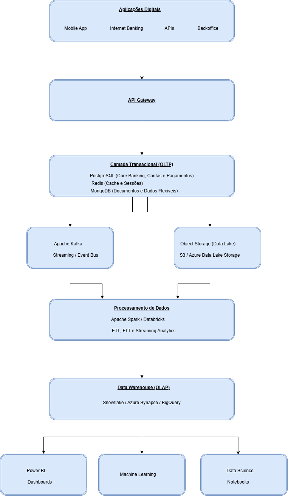

## Proposta de Arquitetura de Dados - QuantumFinance

**1. Desenho da Solução**

---

**2. PostgreSQL - Banco Transacional Principal**

 **Uso**

* Contas bancárias
* Transferências
* Pagamentos
* Clientes
* Operações financeiras

**Justificativa**

Uma Fintech necessita de transações ACID (Atomicidade, Consistência, Isolamento e Durabilidade) para garantir consistência financeira

**Vantagens**

* ACID completo
* Alta confiabilidade
* Replicação nativa
* Open Source
* Excelente desempenho

**Case**

Movimentação bancária e controle de saldo

---

**3. Redis - Cache e Baixa Latência**

**Uso**

* Sessões de usuários
* Tokens JWT
* Consultas frequentes

**Justificativa**

Operações bancárias exigem respostas rápidas

**Vantagens**

* Armazenamento em memória
* Latência inferior a 1 ms
* Redução de carga no PostgreSQL

**Case**

Consulta de saldo e perfil do cliente

---

MongoDB - Dados Não Relacionais

---

Apache Kafka - Streaming de Eventos

---

Data Lake (S3 ou Azure Data Lake)

---

Apache Spark/Databricks

---

Data Warehouse (Snowflake)

---

Power BI

---

Ambiente de Ciência de Dados

---

**Benefícios da Arquitetura**

| Requisito                   | Solução           |
| --------------------------- | ------------------- |
| Transações financeiras    | PostgreSQL          |
| Baixa latência             | Redis               |
| Dados não estruturados     | MongoDB             |
| Processamento em tempo real | Kafka               |
| Armazenamento massivo       | Data Lake           |
| Processamento distribuído  | Spark               |
| Analytics corporativo       | Snowflake           |
| Business Intelligence       | Power BI            |
| Ciência de Dados           | Databricks e Python |

---

**Conclusão**

A arquitetura proposta segue o conceito de **Modern Data Platform**, separando claramente os ambientes **OLTP (transacional)** e **OLAP (analítico)**. Essa abordagem garante que a QuantumFinance consiga crescer com segurança, suportar milhões de transações, processar eventos em tempo real, armazenar grandes volumes de dados e disponibilizar informações confiáveis para BI e Ciência de Dados, mantendo alta escalabilidade, desempenho e governança.
