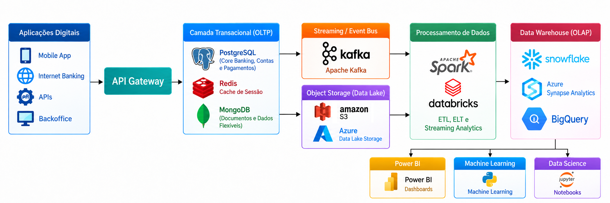

## Proposta de Arquitetura de Dados - QuantumFinance

**Desenho da Solução**

---

**1. PostgreSQL - Banco Transacional Principal**

 **Uso**

* Contas bancárias
* Transferências
* Pagamentos
* Cadastro de clientes
* Operações financeiras

**Justificativa**

Uma Fintech necessita de um banco de dados relacional que ofereça transações ACID (Atomicidade, Consistência, Isolamento e Durabilidade), garantindo a integridade e a consistência dos dados financeiros. O PostgreSQL permite execcutar operações críticas com segurança, como transferências entre contas, evitando inconsistências nos saldos.

**Vantagens**

* Conformidade com ACID: garante a execução confiável de transações financeiras
* Alta confiabilidade: oferece mecanismos de recuperação e proteção dos dados
* Replicação:: suporta replicação física e lógica para diferentes necessidades de disponibilidade e integração
* Open Source: reduz custos com licenciamento e permite personalizações
* Desempenho: oferece recursos de indexação, otimização de consultas e processamento eficiente de transações

**Case**

Movimentação bancária, processamento de transferências  e controle de saldo das contas dos clientes.

---

**2. Redis - Cache e Baixa Latência**

**Uso**

* Armazenamento temporário de sessões de usuários
* Cache de dados relacionados à autenticação e autorização
* Cache de consultas frequentes, como perfil e saldo do cliente

**Justificativa**

Uma Fintech necessita de respostas rápidas para atender às consultas frequentes dos clientes. O Redis, por armazenar dados principalmente em memória, reduz o tempo de resposta e a carga sobre o PostgreSQL, melhorando o desempenho e a escalabilidade da aplicação.

**Vantagens**

* Armazenamento em memória: permite acesso rápido aos dados
* Baixa latência: pode responder em menos de 1 ms em condições adequadas de infraestrutura e carga
* Redução de carga no PostgreSQL: evita consultas repetitivas ao banco de dados principal
* Expiração automática: permite definir um tempo de vida (TTL) para sessões e dados em cache
* Escalabilidade: oferece recursos para distribuir o processamento e atender a um volume elevado de requisições

**Case**

Consulta rápida do perfil do cliente e de informações de saldo previamente armazenadas em cache, com atualização e invalidação adequadas para evitar a apresentação de valores desatualizados.

---

**3. MongoDB - Banco de Dados Não Relacional (NoSQL)**

**Uso**

* Armazenamento de documentos e metadados
* Logs de aplicações
* Histórico de navegação dos usuários
* Perfis de clientes com atributos variáveis

**Justificativa**

Uma Fintech trabalha com dados de diferentes formatos e níveis de estruturação. O MongoDB armazena documentos em formato BSON, permitindo utilizar estruturas flexíveis e adaptar os modelos de dados conforme as necessidades da aplicação.

**Vantagens**

* Schema flexível: permite aramazenar documentos com estruturas diferentes na mesma coleção, respeitando as regras de validação configuradas
* Escalabilidade horizontal: oferece particionamento de dados (sharding) para distribuir grandes volumes de informações
* Evolução dos modelos: facilita a inclusão de novos atributos sem exigir que todos os documentos existentes tenham a mesma estrutura
* Consulta e indexação: permite pesquisar documentos por diferentes campos e criar índices para otimizar as consultas

**Case**

Armazenamento de metadados de comprovantes e documentos KYC (Conheça o Seu Cliente), além de informações complementares dos clientes.

---

**4. Apache Kafka - Streaming de Eventos**

**Uso**

* Publicação de eventos de transações financeiras
* Integração entre sistemas e microsserviços
* Comunicação assíncrona entre aplicações
* Distribuição de eventos para notificações e monitoramento

**Justificativa**

Uma Fintech pode gerar um grande volume de eventos por segundo, exigindo uma plataforma capaz de prrocessar, armazenar temporariamente e distribuir esses eventos de forma escalável e confiável. O Apache Kafka permite integrar sistemas por meio de uma arquitetura orientada a eventos, reduzindo o acoplamento entre os componentes.

**Vantagens**

* Alta escalabilidade: permite distribuir o processamento entre múltiplos servidores
* Processamento de eventos em tempo real: possibilita o consumo contínuo de eventos com baixa latência
* Arquitetura orientada a eventos: facilita a integração assíncrona entre sistemas
* Durabilidade: permite armazenar eventos por um período configurável, conforme a política de retenção
* Múltiplos consumidores: permite que diferentes sistemas processem os mesmos eventos de forma indepenente

**Case**

Cada pagamento confirmado gera um evento, como PagamentoConfirmado, que é publicado no Kafka e consumido por diferentes sistemas, como notificações ao cliente, atualização de indicadores financeiros e análise de fraudes.

---

**5. Data Lake - Armazenamento de Dados em Larga Escala (Amazon S3 ou Azure Data Lake Storage)**

**Uso**

Armazenamento de dados brutos e históricos, incluindo:

* Logs de aplicações e sistemas
* Eventos e transações financeiras
* Arquivos e documentos
* Dados estruturados, semiestruturados e não estruturados

**Justificativa**

Uma Fintech precisa armazenar grandes volumes de dados históricos para auditorias, análises financeiras, monitoramento de operações e treinamento de modelos de Inteligência Artificial. O Data Lake permite centralizar esses dados em um ambiente escalável, com custos de armazenamento geralmente inferiores aos de bancos de dados transacionais.

**Vantagens**

* Alta escalabilidade: permite armazenar grandes volumes de dados conforme a demanda
* Baixo custo por GB: oferece armazenamento econômico, especialmente para dados acessados com pouca frequência
* Flexibilidade: suporta diferentes formatos de dados, como CSV, JSON, Parquet e arquivos de texto
* Integração com Analytics e IA: permite utilizar os dados em ferramentas de processamento analítico, Business Intelligence e Machine Learning
* Retenção histórica: possibilita manter dados por períodos prolongados, conforme as políticas de retenção e os requisitos legais

**Case**

Armazenamento histórico de movimentações financeiras e eventos de transações para auditorias, identificação de padrões de fraude e análise do comportamento financeiro dos clientes.

---

**6. Apache Spark / Databricks - Processamento Distribuído de Dados**

**Uso**

* ETL (Extrair, Transformar e Carregar)
* ELT (Extrair, Carregar e Transformar)
* Processamento distribuído de grandes volumes de dados
* Machine Learning e análise preditiva
* Processamento de dados em batch e streaming

**Justificativa**

Uma Fintech precisa processar grandes volumes de dados para gerar indicadores financeiros, analisar transações e identificar padrões de fraude. O Apache Spark permite realizar processamento distribuído em larga escala, enquanto o Databricks oferece uma plataforma integrada para engenharia de dados, análise e Machine Learning.

**Vantagens**

* Processamento paralelo e distribuído: divide tarefas entre múltiplos recursos computacionais para acelerar o processamento
* Batch e Streaming: permite processar dados históricos e eventos continuamente
* Integração com Data Lakes: suporta a leitura e a transformação de dados armazenados em serviços, como Amazon S3 e Azure Data Lake Storage
* Escalabilidade: permite ajustar os recursos computacionais, conforme o volume de dados
* Machine Learning: oferece reccursos para preparação de dados, treinamento e execução de modelos preditivos

**Case**

Processamento do histórico de transações financeiras para calcular indicadores de desempenho, identificar padrões suspeitos e preparar dados para modelos de score de crédito.

---

**7. Data Warehouse (Snowflake) - Armazenamento Analítico Corporativo**

**Uso**

* Consolidação de dados financeiros e operacionais
* Armazenamento de dados estrututrados para análise

* Criação de indicadores de desempenho (KPIs)
* Disponibilização de dados para ferramentas de Business Intelligence (BI)

**Justificativa**

Uma Fintech precisa consolidar dados provenientes de diferentes sistemas para realizar análises financeiras e apoiar a tomada de decisões. O Data Warehouse permite organizar os dados para consultas analíticas, separando essas cargas de trabalho das operações transacionais executadas no PostgreSQL.

**Vantagens**

* Escalabilidade independente: permite dimensionar os recursos computacionais e de armazenamento, conforme a demanda
* Alto desempenho para BI: otimiza consultas analíticas sobre grandes volumes de dados
* Governança de dados: oferece recursos para controlar acessos e gerenciar os dados
* Integração de fontes: permite consolidar informações de diferentes sistemas em uma visão corporativa
* Separação de cargas de trabalho: reduz a concorrência entre consultas analíticas e operações transacionais

**Case**

Consolidação de receitas, despesas, pagamentos e indicadores financeiros para gerar relatórios gerenciais, acompanhar KPIs e apoiar decisões estratégicas.

---

**8. Power BI - Business Intelligence e Visualização de Dados**

**Uso**

* Dashboards executivos
* Acompanhamento de KPIs financeiros
* Monitoramento operacional
* Análise de desempenho e tendências de negócio

**Justificativa**

Uma Fintech preccisa transformar dados financeiros e operacionais em informações claras e acessíveis para apoiar a tomada de decisões estratégicas. O Power BI permite criar relatórios interativos e dashboards que facilitam o acompanhamento dos indicadores de desempenho da organização.

**Vantagens**

* Visualização interativa: permite explorar dados por meio de gráficos, filtros e relatórios dinâmicos
* Integração com múltiplas fontes: conecta-se a diferentes bancos de dados, serviços em nuvem e plataformas analíticas
* Atualização de dados: permite configurar atualizações programadas ou utilizar modos de conexão que consultam os dados na origem
* Compartilhamento de relatórios: facilita a distribuição de informações entre equipes e gestores, conforme as permissões de acesso
* Integração com ecossistema Microsoft: conecta-se a serviços, como Excel, Azure e Microsoft Fabric
* Reducão do trabalho manual: automatiza a atualização e apresentação de indicadores, reduzinndo a dependência de planilhas elaboradas manualmente
* Suporte à tomada de decisão: facilita a identificação de tendências, desvios e oportunidades de melhoria

**Case**

Criação de um dashboard executivo para acompanhar o volume de transações, o crescimento da carteira de clientes, a taxa de inadimplência, a receita mensal e os indicadores de fraude.

---

**9. Ambiente de Ciência de Dados - Data Science e Machine Learning**

**Uso**

* Previsão de inadimplência
* Detecção de fraudes financeiras
* Análise do comportamento dos clientes
* Segmentação de clientes
* Desenvolvimento e treinamento de modelos de Machine Learning
* Criação de modelos preditivos para apoiar decisões de negócio
* Recomendação personalizada de produtos financeiros

**Justificativa**

As Fintechs utilizam técnicas de Ciência de Dados e Machine Learning para identificar padrões, prever riscos e apoiar decisões estratégicas. Um ambiente de Ciência de Dados permite explorar dados, desenvolver e avaliar modelos preditivos e disponibilizar soluções analíticas para os processos de negócio.

**Vantagens**

* Análise preditiva: permite estimar riscos e antecipar tendências
* Detecção de fraudes: identifica padrões suspeitos nas transações financeiras
* Automação de deciões: permite apoiar ou automatizar decisões com base em modelos analíticos
* Personalização de serviços: possibilita recomendar produtos financeiros de acordo com o perfil dos clientes
* Processamento de grandes volumes de dados: permite analisar históricos extensos para identificar padrões relevantes
* Experimentação e inovação: facilita testar hipóteses, algoritmos e diferentes abordagens analíticas
* Reprodutibilidade dos modelos: permite registrar dados, parâmetros, versões de código e experimentos para reproduzir resultados
* Apoio à tomada de decisão: transforma dados em informações úteis para decisões operacionais e estratégicas
* Escalabilidade: permite ampliar os recursos computacionais, conforme as necessidades de processamento e treinamento

**Case**

Desenvolver um modelo de Machine Learning para detectar transações potencialmente fraudulentas, utilizando o histórico de operações e padrões de comportamento dos clientes. O modelo atribui uma pontuação de risco às transações para auxiliar os sistemas de prevenção à fraudes a decidir quando aprovar, bloquear ou  encaminhar uma operação para análise adicional.

---

**Benefícios da Arquitetura**

| Requisito                   | Solução           |
| --------------------------- | ------------------- |
| Transações financeiras    | PostgreSQL          |
| Baixa latência             | Redis               |
| Dados não estruturados     | MongoDB             |
| Processamento em tempo real | Kafka               |
| Armazenamento massivo       | Data Lake           |
| Processamento distribuído  | Spark               |
| Analytics corporativo       | Snowflake           |
| Business Intelligence       | Power BI            |
| Ciência de Dados           | Databricks e Python |

---

**Conclusão**

A arquitetura proposta segue o conceito de **Modern Data Platform**, separando claramente os ambientes **OLTP (transacional)** e **OLAP (analítico)**. Essa abordagem garante que a QuantumFinance consiga crescer com segurança, suportar milhões de transações, processar eventos em tempo real, armazenar grandes volumes de dados e disponibilizar informações confiáveis para BI e Ciência de Dados, mantendo alta escalabilidade, desempenho e governança.
