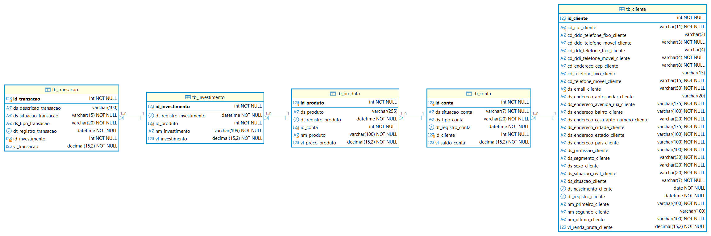

## Proposta de Arquitetura de Dados - QuantumFinance

**Diagrama Entidade Relacionamento (ER)**



---

**Linguagem de Definição de Dados (DDL)**

1. Script de Criação de Tabela

```python
CREATE  TABLE tb_cliente ( 
	id_cliente INT NOT NULL AUTO_INCREMENT,
	nm_primeiro_cliente  VARCHAR(100) NOT NULL,
	nm_segundo_cliente VARCHAR(100),
	nm_ultimo_cliente VARCHAR(100) NOT NULL,
	dt_nascimento_cliente DATE NOT NULL,
	ds_situacao_civil_cliente VARCHAR(20) NOT NULL,
	ds_sexo_cliente VARCHAR(20) NOT NULL,
	ds_profissao_cliente VARCHAR(100) NOT NULL,
	vl_renda_bruta_cliente DECIMAL(15,2) NOT NULL,
	ds_endereco_avenida_rua_cliente VARCHAR(175) NOT NULL,
	ds_endereco_casa_apto_numero_cliente VARCHAR(20) NOT NULL,
	ds_endereco_apto_andar_cliente VARCHAR(20),
	id_endereco_cep_cliente INT(8) NOT NULL,
	ds_endereco_bairro_cliente VARCHAR(100) NOT NULL,
	ds_endereco_cidade_cliente VARCHAR(175) NOT NULL,
	ds_endereco_estado_cliente VARCHAR(100) NOT NULL,
	ds_endereco_pais_cliente VARCHAR(100) NOT NULL,
	id_ddi_telefone_fixo_cliente INT(3),
	id_ddd_telefone_fixo_cliente INT(3),
	id_telefone_fixo_cliente INT(9),
	id_ddi_telefone_movel_cliente INT(3) NOT NULL,
	id_ddd_telefone_movel_cliente INT(3) NOT NULL,
	id_telefone_movel_cliente INT(9) NOT NULL,
	ds_email_cliente VARCHAR(50) NOT NULL,
	dt_registro_cliente DATETIME NOT NULL DEFAULT CURRENT_TIMESTAMP,
	ds_segmento_cliente  VARCHAR(30) NOT NULL,
	ds_situacao_cliente VARCHAR(7) NOT NULL,

	CONSTRAINT pk_id_cliente PRIMARY KEY (id_cliente),
	CONSTRAINT uq_email_cliente UNIQUE (ds_email_cliente)
 );
```

```python
CREATE  TABLE tb_conta ( 
    id_conta INT NOT NULL AUTO_INCREMENT,
    ds_tipo_conta VARCHAR(20) NOT NULL,
    vl_saldo_conta DECIMAL(15,2) NOT NULL,  
    dt_registro_conta DATETIME NOT NULL DEFAULT CURRENT_TIMESTAMP,
    ds_situacao_conta VARCHAR(7) NOT NULL,
    id_cliente INT NOT NULL,
  
    CONSTRAINT pk_id_conta PRIMARY KEY (id_conta),
    CONSTRAINT fk_id_cliente FOREIGN KEY (id_cliente) REFERENCES tb_cliente(id_cliente) 
    ON UPDATE CASCADE 
);
```

```python
CREATE TABLE tb_produto(
    id_produto INT NOT NULL AUTO_INCREMENT,
    nm_produto VARCHAR(100) NOT NULL,
    ds_produto VARCHAR(255),
    vl_preco_produto DECIMAL(15,2) NOT NULL,
    dt_registro_produto DATETIME NOT NULL DEFAULT CURRENT_TIMESTAMP,
    id_conta INT NOT NULL,
  
    CONSTRAINT pk_id_produto PRIMARY KEY (id_produto),
    CONSTRAINT uq_nm_produto UNIQUE (nm_produto),
    CONSTRAINT fk_id_conta FOREIGN KEY (id_conta) REFERENCES tb_conta(id_conta)
    ON DELETE RESTRICT
    ON UPDATE CASCADE
);
```

```python
CREATE TABLE tb_investimento(
    id_investimento INT NOT NULL AUTO_INCREMENT,
    nm_investimento VARCHAR(109) NOT NULL,
    vl_investimento DECIMAL(15,2) NOT NULL,
    dt_registro_investimento DATETIME NOT NULL DEFAULT CURRENT_TIMESTAMP,
    id_produto INT NOT NULL,
  
    CONSTRAINT pk_id_investimento PRIMARY KEY (id_investimento),
    CONSTRAINT fk_id_produto FOREIGN KEY (id_produto) REFERENCES tb_produto(id_produto)
    ON DELETE RESTRICT
    ON UPDATE CASCADE
);
```

```python
CREATE TABLE tb_transacao(
    id_transacao INT NOT NULL AUTO_INCREMENT,
    dt_registro_transacao DATETIME NOT NULL DEFAULT CURRENT_TIMESTAMP,
    vl_transacao DECIMAL(15,2) NOT NULL,
    id_investimento INT NOT NULL,
  
    CONSTRAINT pk_id_transacao PRIMARY KEY (id_transacao),
    CONSTRAINT fk_id_investimento FOREIGN KEY (id_investimento) REFERENCES tb_investimento(id_investimento)
    ON DELETE RESTRICT
    ON UPDATE CASCADE
);
```

2. Script de Inclusão de Dados

```python
		<código fonte>
```

```python
		<código fonte>
```

```python
		<código fonte>
```

```python
		<código fonte>
```

```python
		<código fonte>
```
